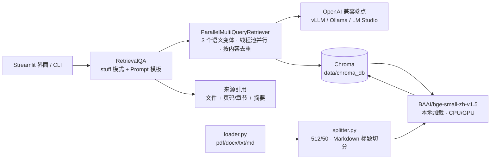

# RAG 智能问答助手 — 面向企业文档的本地化检索增强问答

在本地完成文档解析、向量化与检索，通过 OpenAI 兼容接口对接本地或云端大模型，
回答附带**文件名 + 页码/章节**的来源引用。整套链路支持离线部署，适用于内网或不允许外传文档的场景。

- **技术栈**：LangChain · Chroma · BAAI/bge-small-zh-v1.5 · Streamlit · OpenAI 兼容接口
- **运行方式**：本地向量化 + 本地向量库；LLM 可对接 vLLM / Ollama / LM Studio / 云网关
- **当前状态**：索引构建、多查询检索、来源引用、文档增量上传均已跑通；以《民法典》节选作为验证语料

---

## 效果演示

<!-- 建议放一张 20 秒 GIF：提问 → 回答 → 展开来源引用（文件名 + 章节 + 摘要） -->


---

## 解决的问题

| 需求 | 本项目的做法 |
|---|---|
| 文档不能出内网 | 文档解析、Embedding、向量库全部本地运行；LLM 可指向本地推理服务 |
| 回答要能核对 | 每次回答附带来源文件名、页码或章节层级、命中片段摘要 |
| 单一问题表述影响召回 | 先由模型生成 3 个语义变体问题，并行检索后按内容去重合并 |
| 库里没有的内容不能瞎答 | 检索相似度低于阈值直接丢弃，命中为空时明确回复"根据现有资料无法回答" |
| 装环境需要联网 | 提供离线包（wheel、CPU 版 torch、BGE 模型），可整包拷贝到无网机器安装 |

---

## 架构



**问答链路**：问题 → 生成 3 个变体 → 并行检索 → 命中低于阈值丢弃 → 内容去重合并 → 组装上下文 → 生成回答 → 附来源。

---

## 检索设计

### 多查询并行检索（`src/qa_chain.py`）

继承 LangChain 的 `MultiQueryRetriever` 实现 `ParallelMultiQueryRetriever`：

1. 由 LLM 生成 3 个语义变体问题（生成失败时自动退回原始问题，不中断链路）
2. 变体在 `ThreadPoolExecutor` 中并行检索，串行累加改为并发执行
3. 命中结果按正文内容去重合并，避免同一段落被多个变体重复召回、挤占上下文

### 相似度阈值（关键取舍）

Chroma 在未命中时仍会强制返回 Top-K，导致"库里没有却像查到了"。因此加入阈值过滤：

| 场景 | 实测相似度 |
|---|---|
| 真实命中（问题在语料内） | 约 0.48 以上 |
| 库外问题（含变体改写后） | 最高约 0.37 |
| 默认阈值 | **0.40** |

0.40 可将两类干净分开：低于阈值的命中直接丢弃，上下文为空时回答"根据现有资料无法回答"，
避免用户误判为"已查到原文"。阈值可通过 `RETRIEVAL_SCORE_THRESHOLD` 调整。

### 文档解析与切分

| 环节 | 处理方式 |
|---|---|
| PDF | 按页加载并保留页码元数据，用于溯源 |
| DOCX | 顺序抽取段落与表格，表格转为 Markdown 保留结构 |
| TXT | 自动探测编码（utf-8 → gbk → gb18030） |
| 常规文档 | `RecursiveCharacterTextSplitter(512, 50)`，分隔符针对中文优化（`。！？；，`） |
| 含表格文档 | 先按标题层级切分（`MarkdownHeaderTextSplitter`）保留章节结构，再按 512/50 切分 |

### 来源引用

`answer_with_sources()` 返回 `{question, answer, queries, sources}`，`sources` 每项包含：

- 来源文件名
- 位置：PDF 为页码，Markdown 为标题层级（H1 → H3），其余标注"全文"
- 命中片段摘要（前 150 字符）

---

## 快速开始

### 环境要求

- Python 3.10 ~ 3.12（实测 3.11）
- 可选：NVIDIA GPU（Embedding 可用 GPU 加速，CPU 亦可运行）

### 安装

```bash
# CPU 版 torch（约 200MB；GPU 用户改用 cu121/cu124 源）
pip install torch --index-url https://download.pytorch.org/whl/cpu

# 其余依赖
pip install -r requirements.txt
```

Windows 下可直接双击 `start.bat`，或使用 `offline/install_offline.bat` 走离线安装。

### 配置 LLM

复制 `.env.example` 为 `.env` 后修改三项即可对接任意 OpenAI 兼容服务：

```ini
LLM_BASE_URL=http://localhost:11434/v1   # Ollama 示例
LLM_API_KEY=EMPTY                         # 本地服务通常不校验
LLM_MODEL=qwen2.5:7b
```

| 推理服务 | LLM_BASE_URL | LLM_MODEL 示例 |
|---|---|---|
| vLLM | `http://localhost:8000/v1` | `Qwen/Qwen2.5-7B-Instruct` |
| Ollama | `http://localhost:11434/v1` | `qwen2.5:7b` |
| LM Studio | `http://localhost:1234/v1` | `qwen2.5-7b-instruct` |
| 云端 / 网关 | 按需填写 | 按需填写 |

> 未启动 LLM 时，索引构建、文档上传与检索仍可正常使用；只有"生成回答"依赖 LLM。

### 构建索引

```bash
python -m src.build_index                          # 增量构建
python -m src.build_index --rebuild                # 清空重建
```

流程：加载 `test_samples/` 文档 → 切分 → BGE 向量化 → 写入 Chroma（`data/chroma_db`）。

### 启动

```bash
streamlit run src/app.py       # 网页版
python -m src.cli              # 命令行
```

界面左侧可配置 LLM 端点（含"测试连接"）、管理索引（构建 / 清空重建 / 上传文档）、调节检索参数（K、变体数）。

---

## 离线部署

`offline/` 目录用于无网环境安装（体积约 600MB，已加入 `.gitignore`，不随仓库分发）：

| 目录 | 内容 |
|---|---|
| `offline/pypi/` | 依赖 wheel（镜像预下载） |
| `offline/torch/` | CPU 版 torch |
| `offline/models/` | BGE 中文向量模型（本地加载，免联网） |
| `install_offline.bat` | 一键离线安装 |
| `download_pkgs.bat` | 联网环境重新打包 |

`src/config.py` 会优先检测 `offline/models/bge-small-zh-v1.5`，存在时直接使用本地路径，不回源 HuggingFace。

---

## 验证

`test_samples/` 内置《民法典》合同编 / 总则编 / 婚姻家庭编 / 物权编节选（含 md、txt、docx、pdf 四种格式），
用于验证解析、切分与检索链路：

| 测试问题 | 期望来源 |
|---|---|
| 定金不得超过主合同标的额的多少比例？ | 合同编 第五百八十六条（20%） |
| 因胁迫结婚的，撤销婚姻的请求期限是多久？ | 婚姻家庭编 第一千零五十二条（一年） |
| 诉讼时效期间是几年？ | 总则编 第一百八十八条（三年） |
| 违约金过分高于损失时，法院可以如何处理？ | 合同编 第五百八十五条 |
| 离婚后不满两周岁的子女由谁直接抚养？ | 婚姻家庭编 第一千零八十四条 |
| 业主将住宅改变为经营性用房需要满足什么条件？ | 物权编 第二百七十九条 |

验证方式：构建索引后逐条提问，核对回答与"来源引用"是否指向对应条文。
当前为人工核对，尚未固化为自动化评测（见"后续计划"）。

---

## 设计取舍

| 决策点 | 采用方案 | 放弃的方案 | 原因 |
|---|---|---|---|
| Embedding | 本地 BGE-small-zh-v1.5 | 调用云端 Embedding API | 文档不出内网是硬要求；small 版在 CPU 上可接受，模型仅约 90MB |
| 向量库 | Chroma 本地持久化 | 云端向量数据库 | 单机场景无需运维；HNSW 索引对万级块足够 |
| 召回策略 | MultiQuery 变体 + 并行检索 + 内容去重 | 单次检索 | 单句提问的表述差异会显著影响召回，变体可覆盖同义表述；并行避免三次检索串行叠加延迟 |
| 是否过滤低分命中 | 阈值 0.40 直接丢弃 | 始终返回 Top-K | Chroma 未命中也会强制返回结果，不过滤会让模型拿到无关上下文并给出似是而非的回答 |
| 上下文拼装 | stuff 模式一次性喂入 | map-reduce 分段总结 | 单次上下文可控（K=5），stuff 保真度更高、少一次模型调用 |
| LLM 接入 | OpenAI 兼容协议 | 绑定单一 SDK | 本地推理服务与云厂商均兼容同一套接口，切换只改三个环境变量 |
| 依赖分发 | 提供离线 wheel + 本地模型 | 仅要求联网安装 | 目标环境是内网，装不上就等于交付失败 |

---

## 已知限制

- 对话界面保留历史消息，但检索仅基于当前问题，未做指代消解与多轮上下文改写
- 未引入重排序（rerank）环节，召回质量依赖向量相似度与阈值
- 每轮问答会额外产生一次变体生成调用与 3 次检索，延迟高于单次检索方案
- Chroma 以单机方式运行，未做分布式与并发压测
- 无鉴权与多用户隔离，仅适用于单机或内网小范围使用
- 检索质量目前靠人工核对，缺少量化的召回率/准确率指标

---

## 后续计划

- 增加重排序（bge-reranker）环节，并用固定测试集量化召回率与答案准确率的变化
- 将 6 条验证问题固化为自动化评测脚本，作为每次改动的回归基线
- 支持多轮对话的指代消解（将上一轮问题与当前问题合成为检索查询）
- 增加答案校验：对生成的回答回查引用片段，抑制无依据表述

---

## 目录结构

```
rag-qa-assistant/
├── src/
│   ├── config.py          # 全局配置（环境变量 / .env）
│   ├── loader.py          # 文档加载（pdf / docx / txt / md）
│   ├── splitter.py        # 文本切分（512/50 + Markdown 标题切分）
│   ├── embeddings.py      # BGE 中文向量模型（本地加载）
│   ├── llm.py             # LLM 统一接口（OpenAI 兼容）
│   ├── build_index.py     # 索引构建与增量写入
│   ├── qa_chain.py        # 多查询并行检索 + 来源引用
│   ├── cli.py             # 命令行问答
│   └── app.py             # Streamlit 界面
├── test_samples/          # 验证语料（民法典节选，含 md/txt/docx/pdf）
├── offline/               # 离线安装包（不入库）
├── data/                  # 向量库与运行时数据（不入库）
├── requirements.txt
├── start.bat
└── README.md
```

---

## 已测环境

| 项 | 版本 |
|---|---|
| 系统 | Windows |
| Python | 3.11 |
| 框架 | LangChain 0.2.x / 0.3.x |
| 向量库 | Chroma 0.5.x |
| Embedding | bge-small-zh-v1.5（CPU 可运行） |

---

## 常见问题

| 现象 | 处理 |
|---|---|
| `torch` 安装失败或体积过大 | 使用 CPU 版：`pip install torch --index-url https://download.pytorch.org/whl/cpu` |
| Embedding 模型下载失败 | 设置镜像 `HF_ENDPOINT=https://hf-mirror.com`，或改用 `offline/models/` 本地路径 |
| 回答提示"连接失败" | 确认 LLM 服务已启动，`.env` 中 `LLM_BASE_URL` 正确 |
| 回答"根据现有资料无法回答" | 先看来源引用是否为空：为空表示语料中没有相关内容，需补充文档并重建索引 |
| 命中条文但回答答非所问 | 检查相似度是否低于 0.40 被过滤；可适当调大 `K` |
| Windows 终端中文乱码 | 执行 `chcp 65001` 切换 UTF-8 |

---

## License

MIT
